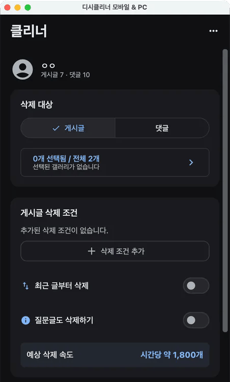

# 디시클리너 (디시 클리너) 모바일 & PC

**내 디시인사이드 게시글과 댓글, 원하는 것만 골라 한 번에 지워요.** 글·댓글 일괄삭제부터 갤로그 정리까지 한 앱으로 해요.
Android, Windows, macOS에서 쓰는 무료 오픈소스 프로그램이에요.

  

> 본인 계정의 게시글과 댓글을 관리하는 용도로만 사용하세요. 디시클리너는 디시인사이드의 공식 프로그램이 아니에요.

---

## 📥 다운로드

**[최신 버전 받기](https://github.com/dccleaner3/dccleaner/releases/latest)**

| 기기 | 파일 |
| :-- | :-- |
| Android | APK |
| Windows | MSI |
| macOS | ZIP (Apple 실리콘 Mac) |
| iPhone | 앱 없이 [초고속 삭제(유료)](https://dccleaner3.github.io/dccleaner/help.html#ultra-iphone)로 서버가 대신 지워 드려요 |

---

## ✨ 주요 기능

### 🗑️ 게시글·댓글 정리
- **글·댓글 한 번에**: 게시글과 댓글을 각각 다른 조건으로 골라 한 번에 이어서 지워요.
- **갤러리별 삭제**: 활동한 갤러리 중 원하는 곳만 골라 지워요.
- **남길 글 지정**: 추천 수나 댓글 수가 일정 이상인 글은 남겨요.
- **댓글 필터**: 내 글에 단 댓글, 디시콘 댓글, 정한 단어나 패턴이 들어간 댓글만 골라요.
- **기간 조건**: 정한 일수보다 오래된 글과 댓글만 지워요.
- **이어하기**: 앱 종료, 네트워크 오류, 캡챠로 멈춘 작업을 그대로 이어서 해요.
- **백그라운드 실행**: Android에서는 화면을 꺼도 계속 지워요.
- **캡챠**: 직접 풀거나 2Captcha로 자동 해결해요. 삭제 중에 키를 넣어도 바로 적용돼요. ([도움말](https://dccleaner3.github.io/dccleaner/help.html#captcha-auto-running))

### ⚡ 초고속 삭제 (유료)
서버가 대신 지워요. **캡챠 없이, 앱을 꺼도 계속, 더 빠르게.**
필요한 만큼만 충전해 쓰고, 남은 개수는 다음에도 쓸 수 있어요.
직접 삭제 중에 충전하면 바로 초고속 삭제로 바꿔 시작할 수 있어요. ([도움말](https://dccleaner3.github.io/dccleaner/help.html#ultra-switch))

### 🧹 댓글 자동 정리
내가 새로 쓴 글에 정한 단어가 들어간 댓글이 달리면 자동으로 지워요. 디시 앱·웹에서 쓴 글도 돼요. ([디시 댓글 자동삭제](https://dccleaner3.github.io/dccleaner/comment-auto-delete.html))

### 💬 방명록 한 번에 보내기
여러 사람의 방명록에 같은 글을 한 번에 남겨요. 갤창랭킹에서 뽑은 식별코드를 받는 사람으로 바로 넣을 수 있고, Android에서는 이미 보낸 사람이 자동으로 빠져요. ([사용법](https://dccleaner3.github.io/dccleaner/guestbook.html))

### 🏆 갤창랭킹
갤러리에서 누가 제일 활발했는지 기간별 순위를 만들어 이미지나 텍스트로 공유해요. ([디시 갤창랭킹 만들기](https://dccleaner3.github.io/dccleaner/gallery-ranking.html))

### 🔎 반고닉 글 찾기
식별코드나 유동 IP로 한 사람이 갤러리에 쓴 글만 골라 모아 봐요. ([디시 반고닉 글 검색](https://dccleaner3.github.io/dccleaner/user-posts.html))

---

## 📚 사용 방법

➡️ [디시클리너 공식 홈페이지 및 사용 방법](https://dccleaner3.github.io/dccleaner/)

- [도움말](https://dccleaner3.github.io/dccleaner/help.html): 로그인·캡챠·초고속 삭제·방명록 문제 해결
- [기능 총정리](https://dccleaner3.github.io/dccleaner/features.html): 댓글 자동 정리·방명록·갤창랭킹·반고닉 글 찾기
- [버그 신고 및 기능 제안](https://github.com/dccleaner3/dccleaner/issues)

---

## 🙏 Credits

이 프로젝트는 아래 프로젝트를 참고해 새로 개발했어요.

https://github.com/dlcjsdltlq/dcinside-cleaner

---

## 🔒 개인정보처리방침

➡️ [개인정보처리방침](PRIVACY.md)

---

## 📄 License

AGPL-3.0

## ⚠️ 면책 조항

본 프로그램은 개인 학습용 및 본인 계정의 데이터 관리(삭제) 용도로만 제공되는 오픈소스예요. 비공식 프로그램을 잘못 사용해 생기는 계정 제한 등의 책임은 전적으로 사용자에게 있어요.
