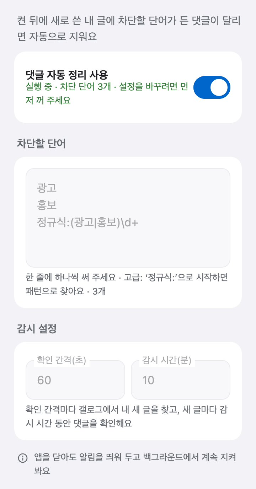

# 디시 댓글 자동삭제

**글만 쓰면 달리는 광고 댓글, 매번 손으로 지우고 계셨나요?**

**댓글 자동 정리**에 차단할 단어를 넣어 두세요. 새로 쓴 내 글에 정한 단어가 들어간 댓글이 달리면, 디시클리너가 알아서 지워 줘요. 광고·홍보 댓글도, 정해 둔 말로 도배하는 댓글도요.

[디시클리너 무료 다운로드](https://github.com/dccleaner3/dccleaner/releases/latest){: .cta} <span class="platforms">Android · Windows · macOS</span>

{: .jump}
[어떻게 동작하나요?](#how-it-works) [사용법](#how-to) [어디서 동작하나요?](#where) [자주 묻는 질문](#faq)

---

## 이런 분께 좋아요

- 글을 쓸 때마다 **광고·홍보 댓글**이 달려서 귀찮은 분
- 특정 단어로 **도배하는 댓글**을 바로 치우고 싶은 분
- 글 올리고 자리를 비워도 **댓글창을 깨끗하게** 두고 싶은 분

## 어떻게 동작하나요? {#how-it-works}

1. 차단할 것을 넣으면 디시클리너가 **내 갤로그의 글 목록**을 정한 간격마다 확인해요.
2. **새 글이 올라오면** 정한 시간 동안 그 글의 댓글을 지켜봐요.
3. **차단할 단어**가 들어간 댓글, **차단할 사람**의 댓글, **차단할 디시콘·팩** 댓글이 보이면 바로 지워요.

{: .tip}
> **💡 디시 앱·웹에서 쓴 글도 돼요** 내 갤로그 글 목록을 보기 때문에, 디시 앱이나 웹에서 쓴 글도 갤로그에 올라오면 지켜봐요.

---

## 사용법 {#how-to}

### 1. 설정 화면 열기

로그인한 뒤 아래 탭 **더보기** → **댓글 자동 정리**를 눌러요.

### 2. 차단할 단어 쓰기

**차단할 것**의 **단어** 탭에 한 줄에 하나씩 써요. 탭 이름 옆 숫자는 넣어 둔 개수예요.

```
광고
홍보
정규식:(광고|홍보)\d+
```

- **일반 단어**: 댓글 내용에 들어 있으면 지워요. 대소문자는 구분하지 않아요.
- **정규식(고급)**: `정규식:`으로 시작하면 패턴으로 찾아요. 여러 단어나 숫자 패턴을 한 줄로 거를 때 좋아요.

### 3. 사람·디시콘도 막기 (선택)

- **사람** 탭: 디시 차단 설정처럼 **식별코드 · IP · 닉네임** 중 하나를 골라 그 칸에 한 줄에 하나씩 써요.
  - **식별코드**: 고닉·반고닉의 식별코드나 갤로그 주소
  - **IP**: 유동 IP 앞 두 자리(`118.235`). 닉 상관없이 그 대역 유동을 막아요. `ㅇㅇ(118.235)`처럼 쓰면 닉과 IP가 둘 다 맞을 때만 막아요.
  - **닉네임**: 고닉·유동 상관없이 그 닉의 댓글을 막아요.
- **디시콘** 탭: **디시콘 고르기**를 누르면 최근 내 글 10개에 달린 디시콘이 많이 받은 순으로 보여요. 콘을 눌러 **이 디시콘만** 또는 **팩 전체**를 막아요. 팩을 막으면 그 팩의 모든 콘이 든 댓글을 지워요.
- 막고 싶은 콘이 목록에 없으면 내 글에 그 콘을 직접 댓글로 달고 다시 불러오세요.
- **디시 앱에서 차단 목록 가져오기**: 디시 앱에 만들어 둔 차단 목록을 한 번에 옮겨요. 디시 앱 **설정 → 전체 설정 백업 및 복원 → 수동 백업**으로 만든 `dcbackup_all_…` 파일을 골라요. **전체 갤러리** 차단만 가져와요.

{: .tip}
> **💡 디시 요청은 거의 늘지 않아요** 팩은 막을 때 한 번(그 뒤 하루 한 번) 팩 정보를 받아 두고, 댓글은 기기에서 바로 비교해요.

### 4. 감시 설정 정하기

| 설정 | 뜻 | 기본값 |
| --- | --- | --- |
| 확인 간격(초) | 새 글과 댓글을 얼마나 자주 확인할지 | 60초 (최소 5초) |
| 감시 시간(분) | 새 글을 찾은 뒤 얼마 동안 댓글을 지켜볼지 | 10분 (최소 1분) |

{: .tip}
> **💡 팁** 댓글이 글 올린 직후에 몰린다면 기본값으로 충분해요. 오래 지켜보고 싶다면 감시 시간을 늘려 보세요.

### 5. 켜기·끄기

따로 켤 필요 없어요. **차단할 것을 하나라도 넣으면 바로 시작**하고, 모두 지우면 꺼져요. 고친 내용은 바로 저장돼요.

<p align="center">
  
</p>

- 맨 위 **자동으로 지우기** 아래에 **지키는 중 · 단어 N개 · 사람 N명 · 디시콘 N개**처럼 지금 적용된 차단 수가 보여요. 고친 뒤 이 숫자가 바뀌면 적용된 거예요.
- 지켜보는 동안 더보기의 **댓글 자동 정리** 줄에 **사용 중**이 붙어요.
- 다시 로그인하면 자동으로 다시 시작해요.
- 지키는 중에도 더하거나 뺄 수 있어요. 손을 멈추고 1초쯤 뒤에 적용되고, 이미 지켜보던 글도 그대로 이어서 봐요. 확인 간격·감시 시간은 칸에서 벗어날 때 적용돼요.
- `정규식:광고|`처럼 모든 댓글에 맞는 패턴은 건너뛰어요(댓글을 전부 지우지 않게).
- 틀린 줄(알아볼 수 없는 사람·틀린 패턴)은 주황색으로 표시되고, 그 줄만 건너뛰고 나머지로 지켜요.

---

## 어디서 동작하나요? {#where}

| 구분 | Android | PC (Windows·macOS) |
| --- | --- | --- |
| 동작 | 백그라운드에서 계속 | 앱이 켜져 있고 로그인한 동안만 |
| 표시 | 알림에 **댓글 자동 정리 중** | 앱 화면 |

다시 로그인하면 넣어 둔 설정으로 **자동으로 다시 시작**해요.

---

## 알아 두면 좋아요 {#tips}

- **시작한 뒤에 새로 쓴 글만** 지켜봐요. 그 전에 쓴 글은 건드리지 않아요.
- 다시 시작하면(다시 로그인, 앱 재실행 등) 그때부터 새로 쓴 글을 지켜봐요. 꺼져 있던 동안 쓴 글은 지켜보지 않아요.
- 정한 감시 시간이 지난 글은 더 이상 확인하지 않아요.
- 댓글과 답글(대댓글) 모두 확인해요. **내가 쓴 댓글이라도** 차단 단어나 차단한 디시콘이 들어 있으면 지워져요(고르려고 직접 달아 본 콘도요).
- 단어를 너무 짧게 잡으면 상관없는 댓글까지 지워질 수 있어요. 처음에는 확실한 단어부터 넣어 보세요.
- 다른 사람이 내 글에 단 댓글은 클리너로 지울 수 없어요. 클리너는 내가 쓴 글·댓글을 [한 번에 지우는](./help.html#delete) 기능이에요.

> 내 글에 달린 댓글을 정리하는 용도로만 사용하세요. 디시클리너는 디시인사이드의 공식 프로그램이 아니에요.

---

## 자주 묻는 질문 {#faq}



---

## 다른 기능도 써 보세요

- [디시 반고닉 글 검색](./user-posts.html): 식별코드·유동 IP로 한 사람의 글을 모아 봐요
- [디시 갤창랭킹 만들기](./gallery-ranking.html)
- [디시 방명록 한 번에 보내기](./guestbook.html)
- [내가 쓴 글·댓글 한 번에 삭제하기](./help.html#both)
- [디시클리너 기능 전체 보기](./features.html)

[디시클리너 최신 버전 다운로드](https://github.com/dccleaner3/dccleaner/releases/latest){: .cta}
