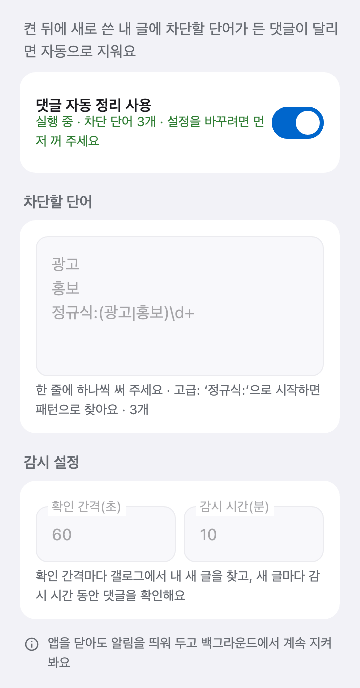

# 디시 댓글 자동삭제

**글만 쓰면 달리는 광고 댓글, 매번 손으로 지우고 계셨나요?**

**댓글 자동 정리**를 켜 두세요. 새로 쓴 내 글에 정한 단어가 들어간 댓글이 달리면, 디시클리너가 알아서 지워 줘요. 광고·홍보 댓글도, 정해 둔 말로 도배하는 댓글도요.

[디시클리너 무료 다운로드](https://github.com/dccleaner3/dccleaner/releases/latest){: .cta} <span class="platforms">Android · Windows · macOS</span>

{: .jump}
[어떻게 동작하나요?](#how-it-works) [사용법](#how-to) [어디서 동작하나요?](#where) [자주 묻는 질문](#faq)

---

## 이런 분께 좋아요

- 글을 쓸 때마다 **광고·홍보 댓글**이 달려서 귀찮은 분
- 특정 단어로 **도배하는 댓글**을 바로 치우고 싶은 분
- 글 올리고 자리를 비워도 **댓글창을 깨끗하게** 두고 싶은 분

## 어떻게 동작하나요? {#how-it-works}

1. 기능을 켜면 디시클리너가 **내 갤로그의 글 목록**을 정한 간격마다 확인해요.
2. **새 글이 올라오면** 정한 시간 동안 그 글의 댓글을 지켜봐요.
3. **차단할 단어**가 들어간 댓글이 보이면 바로 지워요.

{: .tip}
> **💡 디시 앱·웹에서 쓴 글도 돼요** 내 갤로그 글 목록을 보기 때문에, 디시 앱이나 웹에서 쓴 글도 갤로그에 올라오면 지켜봐요.

---

## 사용법 {#how-to}

### 1. 설정 화면 열기

로그인한 뒤 아래 탭 **더보기** → **댓글 자동 정리**를 눌러요.

### 2. 차단할 단어 쓰기

**차단할 단어** 칸에 한 줄에 하나씩 써요.

```
광고
홍보
정규식:(광고|홍보)\d+
```

- **일반 단어**: 댓글 내용에 들어 있으면 지워요. 대소문자는 구분하지 않아요.
- **정규식(고급)**: `정규식:`으로 시작하면 패턴으로 찾아요. 여러 단어나 숫자 패턴을 한 줄로 거를 때 좋아요.

### 3. 감시 설정 정하기

| 설정 | 뜻 | 기본값 |
| --- | --- | --- |
| 확인 간격(초) | 새 글과 댓글을 얼마나 자주 확인할지 | 60초 (최소 5초) |
| 감시 시간(분) | 새 글을 찾은 뒤 얼마 동안 댓글을 지켜볼지 | 10분 (최소 1분) |

{: .tip}
> **💡 팁** 댓글이 글 올린 직후에 몰린다면 기본값으로 충분해요. 오래 지켜보고 싶다면 감시 시간을 늘려 보세요.

### 4. 켜기

화면 맨 위의 **댓글 자동 정리 사용**을 켜요. 켤 때 설정을 확인하고 저장해요.

<p align="center">
  
</p>

- 스위치 아래에 **실행 중 · 차단 단어 N개**가 보여요.
- 지켜보는 동안 더보기의 **댓글 자동 정리** 줄에 **사용 중**이 붙어요.
- 켜 둔 상태도 기억해요. 다시 로그인하면 자동으로 다시 시작해요.

### 5. 끄기·설정 바꾸기

실행 중에는 설정을 바꿀 수 없어요. **끄고 → 바꾸고 → 다시 켜요.**

---

## 어디서 동작하나요? {#where}

| 구분 | Android | PC (Windows·macOS) |
| --- | --- | --- |
| 동작 | 백그라운드에서 계속 | 앱이 켜져 있고 로그인한 동안만 |
| 표시 | 알림에 **댓글 자동 정리 중** | 앱 화면 |

다시 로그인하면 켜 두었던 설정으로 **자동으로 다시 시작**해요.

---

## 알아 두면 좋아요 {#tips}

- **켠 뒤에 새로 쓴 글만** 지켜봐요. 켜기 전에 쓴 글은 건드리지 않아요.
- 다시 시작하면(다시 로그인, 앱 재실행 등) 그때부터 새로 쓴 글을 지켜봐요. 꺼져 있던 동안 쓴 글은 지켜보지 않아요.
- 정한 감시 시간이 지난 글은 더 이상 확인하지 않아요.
- 댓글과 답글(대댓글) 모두 확인해요. **내가 쓴 댓글이라도** 차단 단어가 들어 있으면 지워져요.
- 단어를 너무 짧게 잡으면 상관없는 댓글까지 지워질 수 있어요. 처음에는 확실한 단어부터 넣어 보세요.
- 다른 사람이 내 글에 단 댓글은 클리너로 지울 수 없어요. 클리너는 내가 쓴 글·댓글을 [한 번에 지우는](./help.html#delete) 기능이에요.

> 내 글에 달린 댓글을 정리하는 용도로만 사용하세요. 디시클리너는 디시인사이드의 공식 프로그램이 아니에요.

---

## 자주 묻는 질문 {#faq}



---

## 다른 기능도 써 보세요

- [디시 반고닉 글 검색](./user-posts.html): 식별코드·유동 IP로 한 사람의 글을 모아 봐요
- [디시 갤창랭킹 만들기](./gallery-ranking.html)
- [디시 방명록 한 번에 보내기](./guestbook.html)
- [내가 쓴 글·댓글 한 번에 삭제하기](./help.html#both)
- [디시클리너 기능 전체 보기](./features.html)

[디시클리너 최신 버전 다운로드](https://github.com/dccleaner3/dccleaner/releases/latest){: .cta}
