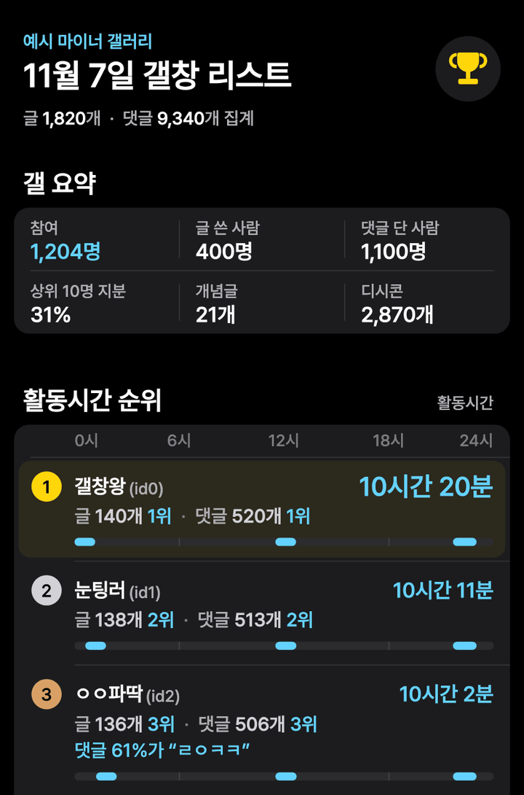
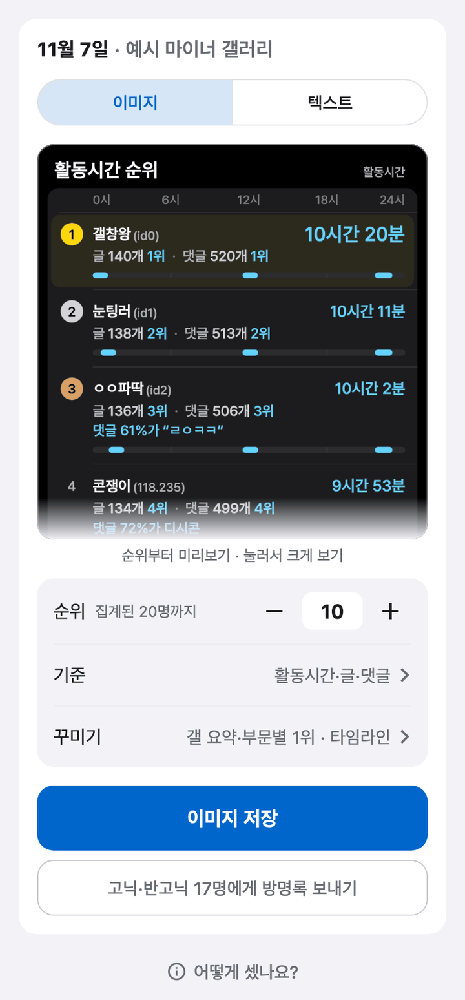

# 디시 갤창랭킹 만들기

**"우리 갤 갤창 누구야?"** 이제 직접 세지 마세요.

갤러리 주소만 넣으면 디시클리너가 그 기간의 글과 댓글을 모아 갤창 순위를 만들어 줘요. 이미지로 저장해서 바로 올릴 수도 있어요.

[디시클리너 무료 다운로드](https://github.com/dccleaner3/dccleaner/releases/latest){: .cta} Android · Windows · macOS

{: .jump}
[무엇을 보여 주나요?](#what) [사용법](#how-to) [방명록 보내기](#to-guestbook) [알아 두면 좋아요](#tips) [자주 묻는 질문](#faq)

---

## 이런 분께 좋아요

- 우리 갤 **오늘의 갤창**이 누군지 궁금한 분
- 주간·월간 **갤창 순위**를 정리해서 올리고 싶은 분
- 갤창랭킹 사이트를 찾다가 **직접 만들고 싶어진** 분
- 마이너·미니 갤러리라 순위를 보여 주는 곳이 없는 분

## 무엇을 보여 주나요? {#what}

  

순위 기준은 열두 가지예요. 결과에서 원하는 것만 골라요.

| 순위 | 기준 |
| --- | --- |
| 활동시간 | 갤러리에서 활동한 시간이 긴 순서 |
| 글 | 글을 많이 쓴 순서 |
| 댓글 | 댓글을 많이 쓴 순서 |
| 개념글 | 개념글이 많이 간 순서 (실시간 베스트로 간 글도 개념글로 세요) |
| 무플 글 | 댓글이 하나도 안 달린 글이 많은 순서 |
| 평균 조회수 | 글 하나의 평균 조회수가 높은 순서 (개념글은 빼고, 그런 글 3개 이상) |
| 총 받은 댓글 | 내 글에 남이 단 댓글이 많은 순서 (개념글과 내가 단 댓글은 빼고 세요) |
| 글 1개당 받은 댓글 | 내 글 하나에 달린 평균 댓글이 많은 순서 (개념글은 빼고, 그런 글 3개 이상) |
| 받은 댓글에 답한 비율 | 내 글에 달린 남의 댓글에 답글을 많이 단 순서 (내 글에 남이 단 댓글 10개 이상) |
| 글댓비 | 글 1개에 댓글을 많이 쓰는 순서, 1 : N (글 3개 이상) |
| 글자 댓글 | 디시콘을 뺀 댓글이 많은 순서 |
| 디시콘 댓글 | 디시콘 댓글을 많이 단 순서 |

순위와 함께 갤 전체 묶음도 넣을 수 있어요.

| 묶음 | 내용 |
| --- | --- |
| 갤 요약 | 참여한 사람 수, 글 쓴 사람·댓글 단 사람 수, 상위 10명 지분, 개념글 수, 디시콘 수 |
| 부문별 1위 | 념글왕(개념글)·무플왕(무플 글)·조회수왕(평균 조회수)·어그로왕(총 받은 댓글)·평댓왕(글 1개당 받은 댓글)·소통왕(받은 댓글에 답한 비율)·댓글러왕(글댓비)·실댓왕(글자 댓글)·콘창왕(디시콘 댓글) |
| 인기글 | 조회수 순위와 댓글 순위의 평균이 높은 글 6개를 **개념글 포함**과 **개념글 제외**로 각각 |
| 키워드 | 그 기간 글 제목에 많이 나온 말을 구름 그림과 키워드 순위(1~10위)로 |

- 이미지·텍스트 모두 **갤 요약 → 순위 → 부문별 1위 → 인기글 → 키워드** 순서로 들어가요. 먼저 찾는 순위가 빨리 보이게 갤 요약은 낮게 한 줄 세 칸으로 넣어요.
- 보이는 값이 같으면 같은 순위예요. 같은 순위 안에서는 그 값의 바탕이 된 개수가 많은 사람이 앞에 와요(예: 글 1개당 받은 댓글이 같으면 받은 댓글이 많은 사람).
- 이미지에는 사람마다 아래에 한 줄로 **시간·글·댓글 중 나머지 값과 그 부문 순위**가 붙어요. 글 1개당 받은 댓글·글댓비·받은 댓글에 답한 비율 같은 다른 값은 각자 순위 기준으로 골라 보면 돼요.
- 키워드는 띄어쓰기로 나누고 끝의 조사(은·는·을·를 등)만 떼어서 세요. 그래서 "갤창이"와 "갤창"처럼 따로 세는 말이 있어요. 기본 닉(ㅇㅇ) 유동 글도 인기글·키워드에는 들어가요.

- **고닉·반고닉**은 닉네임 옆에 아이디가, **유동**은 IP 앞자리가 붙어요.
- **하루짜리** 이미지의 **활동시간**에는 하루 중 언제 활동했는지 보여 주는 **타임라인**이 들어가요. 다른 순위에는 넣지 않아요.
- 하루짜리 이미지에는 그날 댓글이 10개 넘는 사람 중 같은 말을 절반 이상 반복했으면 **댓글 61%가 "ㄹㅇㅋㅋ"**처럼, 디시콘을 절반 이상 썼으면 **댓글 72%가 디시콘**처럼 붙어요.
- 보이는 값이 같은 사람은 같은 순위 번호를 받아요(1, 1, 3위…). 카드 아래 줄의 "글 N위·댓글 N위"도, 하루 평균으로 볼 때는 반올림해 보이는 값으로 세요. 이미지·텍스트 모두 같아요.
- 부문별 1위가 공동이면 두 명은 "A·B", 셋 이상은 "A 외 N명"으로 적어요.
- 키워드 구름에는 키워드 순위 1~10위 말이 모두 들어가고, 1위가 가장 크게 보여요.

---

## 사용법 {#how-to}

### 1. 갤창랭킹 화면 열기

로그인한 뒤 아래 탭 **더보기** → **갤창랭킹**을 눌러요.

### 2. 갤러리 넣기

**갤러리 주소 또는 ID** 칸에 갤러리를 넣어요. 이런 것들이 다 돼요.

- PC 주소: `https://gall.dcinside.com/board/lists/?id=갤러리ID`
- 마이너·미니 갤러리 주소
- 모바일 주소: `https://m.dcinside.com/board/갤러리ID`
- 갤러리 ID만

### 3. 기간 고르기

**하루 · 주 · 달** 중에서 골라요.

| 단위 | 세는 범위 | 처음 고른 값 |
| --- | --- | --- |
| 하루 | 그날 0시~24시 | 어제 |
| 주 | 월요일~일요일 | 지난주 |
| 달 | 1일~말일 | 지난달 |

- **◀ ▶** 화살표로 한 칸씩 옮겨요.
- 하루는 **달력에서 날짜 고르기**로 날짜를 바로 고를 수 있어요.
- 오늘이나 이번 주·이번 달을 고르면 **지금까지의 활동만** 세요.

{: .tip}
> **💡 팁** 기간이 길수록 오래 걸려요. 처음엔 하루로 가볍게 만들어 보세요.

### 4. 만들기

**갤창랭킹 만들기**를 눌러요. 화면에 3단계 진행 상황이 보여요.

1. 갤러리를 확인하고 있어요
2. 글을 모으고 있어요
3. 댓글을 모으고 있어요

- 글·댓글을 모을 때는 그 단계가 끝날 때까지 **남은 시간**(예: 이 단계 약 3분 남았어요)이 보여요. 처음 몇 초는 계산 중으로 나오고, 글이 몰린 시간대에 따라 조금씩 바뀔 수 있어요.
- 댓글은 글보다 훨씬 오래 걸릴 수 있어요. 기다리기 어려우면 댓글을 모으는 중에 **댓글 건너뛰고 글로만 만들기**를 눌러요. 한 번 더 묻는 창에서 **건너뛰기**를 누르면 그때까지 모은 댓글은 버리고 **글 목록으로만** 만들어요. 결과에는 댓글 수와 활동시간·댓글·디시콘·글자 댓글·글댓비·받은 댓글에 답한 비율, 타임라인이 나오지 않아요(댓글 없이는 정확히 알 수 없어서 빼요). 총 받은 댓글·무플 글·글 1개당 받은 댓글·평균 조회수·개념글·인기글·키워드는 글 목록만으로 세서 그대로 나와요. 다만 받은 댓글은 목록의 댓글 수라 내가 내 글에 단 댓글도 들어가요.
- **Android**: 다른 화면으로 가거나 앱을 내려도 계속 만들어요. 알림에 진행 상황과 남은 시간이 보이고, 다 만들어지면 **갤창랭킹이 완성됐어요** 알림이 떠요(갤창랭킹 화면을 보고 있으면 결과가 바로 보여서 알림은 안 떠요). 알림을 누르면 갤창랭킹 화면으로 바로 가요.
- **PC**: 다른 화면으로 가도 계속 만들어요. 다른 탭이나 다른 창을 보고 있으면 다 만들어졌을 때(또는 만들지 못했을 때) 알림으로 알려 줘요. 앱을 닫으면 멈춰요.
- 그만두려면 **만들기 취소**를 누르고, 한 번 더 묻는 창에서 다시 **만들기 취소**를 눌러요. 지금까지 모은 건 사라지고, 다시 만들면 처음부터 모아요.

### 5. 결과 보고 공유하기

  

결과가 나오면 맨 위에 **미리보기**, 그 아래 옵션 몇 줄, 맨 아래 **이미지 저장**(텍스트면 **텍스트 복사**) 버튼이 보여요. 기본값 그대로면 바로 저장하면 돼요. 처음에는 하루·주·달 모두 이미지로 보여요. 옵션을 바꾸고 **완료**를 누르면 미리보기에서 볼 수 있어요.

- 미리보기는 앞부분만 보여요(미리보기 위에서 밀면 화면 전체가 내려가요). **누르면 크게** 볼 수 있어요. 텍스트도 누르면 전체를 볼 수 있어요. 크게 보기에서는 훨씬 길게(아주 긴 이미지는 앞쪽 상당 부분까지) 내려 볼 수 있어서 1~3위와 내 닉을 확인할 수 있어요. 크게 보기 아래의 **이미지 저장**(텍스트면 **텍스트 복사**)으로 바로 저장할 수도 있어요. 저장하거나 복사하면 전체가 들어가요.

| 옵션 | 설명 |
| --- | --- |
| 순위 | 몇 위까지 보일지 정해요. 기본 10위, **−/+**로 5·10·20·30·50·100위 단계로 바꾸거나(100위 위로는 100위씩) 숫자를 직접 써요. 집계된 사람 수까지만 늘릴 수 있어요. |
| 기준 | 누르면 아래에서 목록이 올라와요. 위 열두 가지 중 여러 개를 고르면 목록 순서대로 이어 붙어요. 하루는 활동시간·글·댓글, 주·달은 글·댓글이 기본이에요. 댓글을 건너뛰었으면 댓글이 필요한 기준은 흐리게 보이고 이유가 적혀 있어요. |
| 값 보기 (주·달만) | **기간 합계**와 **하루 평균** 중 골라요. |
| 꾸미기 | 누르면 아래에서 목록이 올라와요. **함께 넣기**(순위 앞: 갤 요약 / 순위 뒤: 부문별 1위·인기글·키워드), **타임라인**(하루 이미지에서 활동시간을 골랐을 때만, 댓글을 건너뛴 결과에는 없음)을 정해요. 함께 넣기는 처음에 **갤 요약·부문별 1위만** 켜져 있어요. |

- 고른 순위 수·기준·함께 넣기·타임라인·값 보기는 **저장돼서** 새로 만들거나 앱을 껐다 켜도 그대로예요. 기준은 하루와 주·달을 따로 기억해요.

- **이미지 저장**: 고른 기준을 위에서 아래로 이어 붙여 **한 장**으로 저장해요. 디시의 자동 축소에 걸리지 않게 가로 840px로 저장해요. 세로가 약 49,000px을 넘으면 디시에 올라가지 않아서 **이미지 N장 저장**으로 나눠 저장해요. 미리보기는 앞부분만 보여 줘요.
  - Android: 사진 앱의 **DCCleaner** 앨범 (Android 9 이하는 저장 후 알려 주는 앱 전용 폴더)
  - PC: 다운로드 폴더 안 **DCCleaner 갤창랭킹** 폴더
- **텍스트 복사**: 순위를 글로 복사해요. 갤러리에 바로 붙여 넣기 좋아요.

결과 아래 **어떻게 셌나요?**를 누르면 이 결과를 셀 때 뺀 것(기본 닉 유동, 개념글, 내가 단 댓글, 삭제된 글 등)을 볼 수 있어요.

다른 갤러리를 보려면 **다른 갤러리·기간으로 새로 만들기**를 눌러요. 지금 결과는 사라지기 때문에 한 번 더 물어요. 새로 만들 때 갤러리 주소 칸은 비워지고 기간은 그대로예요. 필요하면 먼저 이미지로 저장하거나 텍스트를 복사해 두세요.

#### 집계된 사람들에게 방명록 보내기 {#to-guestbook}

결과의 **고닉·반고닉 N명에게 방명록 보내기**를 누르면 [방명록](./guestbook.html#from-ranking) 화면으로 가고, 받는 사람에 식별코드가 채워져요. 메시지를 쓰고 **N명에게 보내기**는 직접 눌러요.

- 순위 수와 상관없이 그 기간에 집계된 **고닉·반고닉 모두**가 들어가요. 유동(IP)은 방명록을 받을 수 없어 빠져요.
- 닉네임을 바꿔 두 번 잡힌 사람도 한 번만 들어가요.
- 방명록을 보내는 중에는 이 버튼이 꺼지고 **방명록을 보내는 중이에요**라고 보여요. 다 보낸 뒤 눌러 주세요.

---

## 알아 두면 좋아요 {#tips}

- 랭킹을 만들 때 **내 계정으로 글을 쓰거나 지우지 않아요.** 공개된 글 목록과 댓글만 읽어요.
- **기본 닉(ㅇㅇ) 유동**은 순위에서 빠져요. 그 기간 글과 댓글을 모두 ㅇㅇ 유동이 썼으면 순위가 비어 있어요.
- 결과는 화면이나 탭을 옮겨도 남아 있어요. 로그아웃하거나 앱을 완전히 종료하면 지워져요.

> 디시클리너는 디시인사이드의 공식 프로그램이 아니에요. 만든 순위는 공개된 글을 센 참고용 자료예요.

---

## 자주 묻는 질문 {#faq}



---

## 다른 기능도 써 보세요

- [디시 반고닉 글 검색](./user-posts.html): 식별코드·유동 IP로 한 사람의 글을 모아 봐요
- [디시 방명록 한 번에 보내기](./guestbook.html)
- [디시 댓글 자동삭제](./comment-auto-delete.html): 내 글의 광고 댓글을 알아서 지워요
- [디시클리너 기능 전체 보기](./features.html)

[디시클리너 최신 버전 다운로드](https://github.com/dccleaner3/dccleaner/releases/latest){: .cta}
