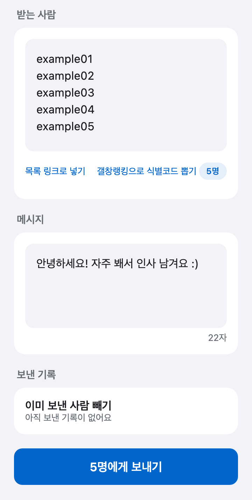

# 디시 방명록 한 번에 보내기

**갤로그 방명록, 아직도 한 명씩 들어가서 쓰고 계세요?**

디시클리너에 **식별코드 목록**과 **메시지**만 넣으면, 여러 사람의 방명록에 같은 글을 한 번에 남겨요. 목록이 없으면 **갤창랭킹**으로 갤러리에서 활동한 사람들의 식별코드를 바로 뽑을 수 있어요.

[디시클리너 무료 다운로드](https://github.com/dccleaner3/dccleaner/releases/latest){: .cta} Android · Windows · macOS

{: .jump}
[사용법](#how-to) [갤창랭킹에서 가져오기](#from-ranking) [이미 보낸 사람 빼기](#skip-sent) [알아 두면 좋아요](#tips) [자주 묻는 질문](#faq)

---

## 이런 분께 좋아요

- 갤러리 사람들에게 **인사나 공지**를 방명록으로 돌리고 싶은 분
- **고정닉 목록**에 있는 사람들에게 한 번에 남기고 싶은 분
- **우리 갤러리에서 자주 보이는 사람들**에게 인사를 남기고 싶은 분
- 방명록 매크로를 찾다가 **안전하게 차례대로** 보내는 방법을 찾는 분

---

## 사용법 {#how-to}

### 1. 방명록 열기

로그인한 뒤 아래 탭 **더보기** → **방명록**을 눌러요.

### 2. 받는 사람 넣기

**받는 사람** 칸에 **식별코드**를 한 줄에 하나씩 써요. 닉네임은 안 돼요.

  

- 오른쪽에 **N명**으로 몇 명인지 바로 보여요. 겹치는 식별코드는 한 번만 세요.
- 식별코드는 갤로그 주소 `gallog.dcinside.com/식별코드`의 끝부분이에요. 고닉·반고닉 모두 갤로그 아이디와 같아요.
- 1,000명이 넘으면 입력칸 대신 **식별코드 N개**로 개수와 앞 몇 명만 보여 줘요. 수만 명을 넣어도 화면이 느려지지 않아요. 고치려면 **비우기**로 지운 뒤 다시 넣어요.

#### 갤창랭킹에서 가져오기 {#from-ranking}

갤러리에서 활동한 사람들에게 보내고 싶다면 목록을 따로 찾을 필요가 없어요.

1. 받는 사람 칸 아래 **갤창랭킹으로 식별코드 뽑기**를 눌러요. 갤창랭킹 화면으로 가요.
2. 갤러리와 기간을 정해 [갤창랭킹을 만들어요](./gallery-ranking.html). 이미 만든 결과가 있으면 그 결과가 바로 보여요.
3. 결과에서 **수집된 유저 N명에게 방명록 보내기**를 누르면 방명록으로 돌아오고, 받는 사람에 식별코드가 채워져요.
4. 메시지를 쓰고 직접 **N명에게 보내기**를 눌러요. 자동으로 보내지는 않아요.

- 화면에 보이는 순위 수와 상관없이 **그 기간에 집계된 고닉·반고닉 모두**가 들어가요. 유동(IP)은 방명록을 받을 수 없어 빠져요.
- 받는 사람 칸에 써 둔 목록은 새 목록으로 **바뀌어요**.
- 방명록을 보내는 중에는 갤창랭킹의 방명록 보내기 버튼이 꺼져 있어요. 다 보낸 뒤 눌러 주세요.

{: .tip}
> **💡 다른 목록이 필요하면?** 구글에서 “갤러리명 + 차단 목록(또는 고정닉 목록) + 내 식별코드”로 검색해 보세요. 갤러리마다 사람들이 정리해 둔 목록이 있을 때가 많아요.

  

#### 목록 링크로 넣기

식별코드**만** 한 줄에 하나씩 적힌 글자(텍스트) 페이지라면 주소를 그대로 넣어도 돼요. (예: GitHub Gist의 Raw 주소) 블로그·게시글 같은 일반 웹페이지 주소는 명단을 제대로 불러오지 못해요.

1. **목록 링크로 넣기**를 눌러 안내를 확인해요.
2. `https://`로 시작하는 주소를 한 줄에 하나씩 넣어요. 여러 개도 돼요.
3. 메시지까지 쓴 뒤 **명단 불러오기**를 누르면 목록을 불러와 합치고 겹치는 식별코드를 없앤 다음, 바로 **N명에게 보낼까요?** 확인 창이 떠요.

{: .warn}
> **⚠️ 주의** 식별코드와 링크는 한 칸에 섞어 쓸 수 없어요.

### 3. 메시지 쓰기

**메시지** 칸에 남길 말을 써요. 아래에 글자 수가 보여요.

### 4. 보내기

1. **N명에게 보내기**를 눌러요.
2. **N명에게 보낼까요?** 창에서 한 번 더 확인해요. 보낸 뒤에는 되돌릴 수 없어요.
3. **N명에게 보내기**를 누르면 시작해요.

보내는 동안 **보내는 중 3 / 50명**처럼 진행 상황이 보여요. 끝나면 **모두 보냈어요** 또는 **성공 N명 · 실패 N명**으로 결과를 알려 줘요.

---

## 이미 보낸 사람 빼기 (Android) {#skip-sent}

Android 앱은 이 계정으로 **보내는 데 성공한 사람을 기억**해요.

- **보낸 기록** 칸의 **이미 보낸 사람 빼기**에 **보낸 적 있는 N명은 자동으로 빼요**가 보여요.
- 다음에 같은 목록으로 보내도 **새로운 사람에게만** 가요. 지난번에 실패한 사람은 다시 보내요.
- 다시 모두에게 보내려면 **초기화** → **지우기**를 눌러요.
- 목록이 모두 이미 보낸 사람이면 **모두 이미 보낸 사람이에요**라고 알려 줘요.

PC 앱에는 이 기능이 없어요. 목록 안에서 겹치는 식별코드만 빼요.

---

## 알아 두면 좋아요 {#tips}

- **한 사람에게 한 번씩, 차례대로** 보내요. 실패해도 다시 시도하지 않아요.
- 비밀글이 아닌 **일반 방명록**으로 남겨요.
- **Android**는 다른 앱을 써도 계속 보내요.

> 본인 계정으로, 받는 사람이 불편하지 않은 내용만 보내 주세요. 같은 글을 너무 많이 보내면 디시인사이드 정책에 따라 제한될 수 있어요. 디시클리너는 디시인사이드의 공식 프로그램이 아니에요.

---

## 자주 묻는 질문 {#faq}



---

## 다른 기능도 써 보세요

- [디시 갤창랭킹 만들기](./gallery-ranking.html)
- [디시 반고닉 글 검색](./user-posts.html)
- [디시 댓글 자동삭제](./comment-auto-delete.html)
- [디시클리너 기능 전체 보기](./features.html)

[디시클리너 최신 버전 다운로드](https://github.com/dccleaner3/dccleaner/releases/latest){: .cta}
