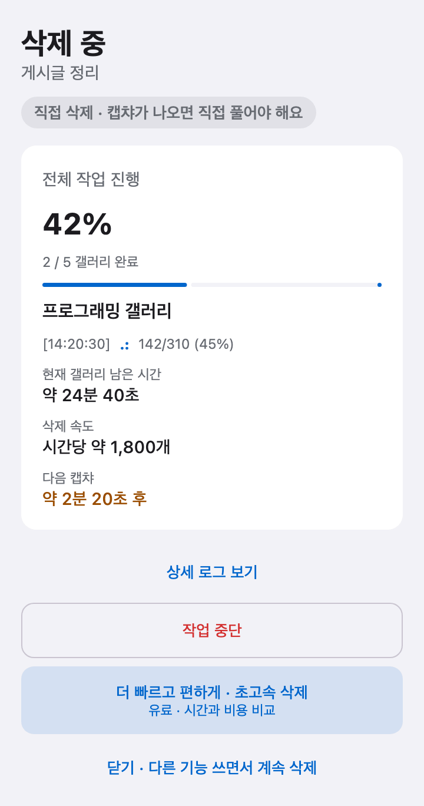
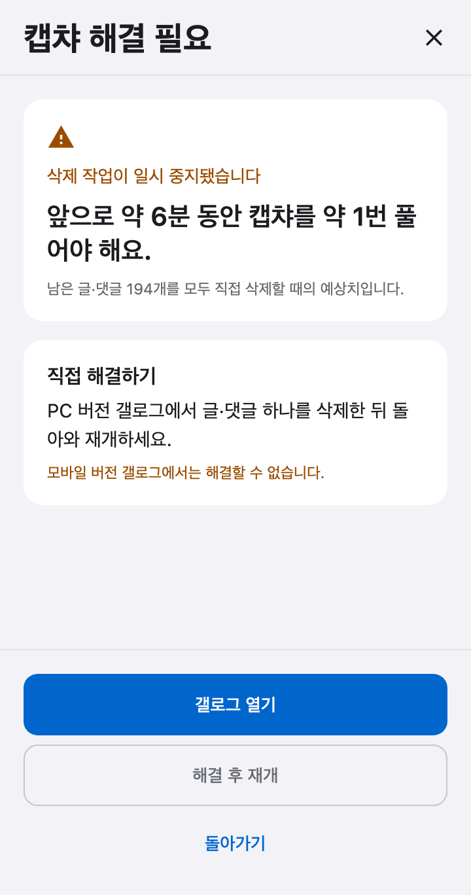

# 디시클리너 사용법·도움말

자주 묻는 질문을 모았어요. 궁금한 항목을 눌러 바로 확인하세요.

- [시작하기](#start)
- [설치가 안 될 때](#install)
- [새 버전 받기](#update)
- [로그인](#login)
- [삭제와 캡챠](#delete)
- [초고속 삭제와 충전](#ultra)
- [방명록 전송](#guestbook)
- [더보기 기능](#more)
- [문의하기](#contact)

---

## 시작하기 {#start}

### 어디서 다운로드하나요? {#download}

[최신 버전 받기](https://github.com/dccleaner3/dccleaner/releases/latest)에서 기기에 맞는 파일을 받으세요.

- **Android**: APK 파일
- **Windows**: MSI 파일
- **macOS**: ZIP 파일 (Apple 실리콘 Mac만 지원해요)
- **iPhone**: 앱은 없지만 [초고속 삭제](#ultra-iphone)로 서버가 대신 지워 드려요.

### 설치가 안 되거나 실행이 막혀요 {#install}

- **Android**: 설치할 때 '출처를 알 수 없는 앱' 설치를 허용해 달라는 창이 뜨면 허용한 뒤 APK를 다시 열어 주세요. (메뉴 이름은 휴대폰마다 조금 달라요)
- **macOS**: 처음 열 때 막히면 앱을 우클릭하고 **열기**를 눌러 주세요.
- **Windows**: 'Windows의 PC 보호' 창이 뜨면 **추가 정보 → 실행**을 눌러 주세요.

### 새 버전은 어떻게 받나요? {#update}

새 버전이 나오면 앱 위쪽에 **새 버전** 안내가 떠요. **업데이트**를 누르면 PC는 앱이 직접 받아서 설치해요. Android는 브라우저가 새 버전을 받고, 다 받으면 다운로드 알림을 눌러 설치해요. 삭제나 방명록 작업이 도는 중에는 끝난 뒤에 업데이트할 수 있어요.

- **Windows·macOS**: 설치가 끝나면 앱이 다시 켜져요. Mac에서 앱을 응용 프로그램 폴더가 아닌 곳에서 실행 중이면 새 버전을 Finder에 보여 드리니, 응용 프로그램 폴더로 옮겨 주세요.
- **Android**: 처음 한 번은 디시클리너에 '이 출처 허용'을 켜고 **설치**를 눌러 주세요. 그다음부터는 누르지 않아도 바로 설치돼요. 설치가 끝나면 앱이 닫히니 알림을 눌러 다시 열어 주세요.
- 갤럭시에서 **자동 차단**이 켜져 있으면 설치가 막혀요. 설정 → 보안 및 개인정보 보호 → 자동 차단에서 끈 뒤 다시 해 주세요.
- 앱 안에서 안 되면 [최신 버전 받기](https://github.com/dccleaner3/dccleaner/releases/latest)에서 직접 받아 설치하면 돼요.

디시클리너가 처음이라면 [소개 페이지](./)를 먼저 확인하세요.

---

## 로그인 {#login}

### 로그인이 안 돼요 {#login-failed}

1. 아이디와 비밀번호가 맞는지 확인하세요.
2. 디시인사이드 2단계 인증이 켜져 있으면 로그인이 실패할 수 있어요. 2단계 인증을 끄고 다시 시도하세요.

### 로그인 정보는 어디로 가나요? {#privacy}

- 로그인할 때 아이디와 비밀번호는 디시인사이드로만 보내요.
- '로그인 정보 저장'을 켜면 기기의 보안 저장소에만 저장해요.
- 초고속 삭제를 쓸 때만 별도로 동의를 받고, 암호화(AES-256)해서 서버로 보내요. 작업이 끝나면 완료·실패·취소와 관계없이 바로 폐기해요.

자세한 내용은 앱의 **더보기 > 개인정보처리방침**에서 확인하세요.

---

## 삭제와 캡챠 {#delete}

### 삭제 속도는 어느 정도인가요? {#speed}

직접 삭제는 시간당 약 1,800개를 지워요(일부 조건을 켜면 약 900개). 약 200개를 지울 때마다 캡챠가 한 번 나와요.

더 빠르게 지우고 싶다면 [초고속 삭제](#ultra)를 이용하세요.

### 게시글과 댓글을 한 번에 지울 수 있나요? {#both}

네. **클리너** 탭의 **게시글**과 **댓글**을 둘 다 체크하면 함께 지워요.

- 각 줄의 **설정**에서 갤러리와 조건을 따로 정해요. 갤러리 목록에는 마이너·미니 갤러리 표시가 붙어요(처음에는 갤러리마다 하나씩 확인해서, 선택 창의 갤러리 수 옆과 목록 위 막대로 진행이 보여요).
- 정한 조건은 앱을 다시 켜도 남아요. 처음으로 돌리려면 설정의 **조건** 오른쪽 **초기화**를 눌러 주세요. 고른 갤러리와 **삭제 제한 말머리 글도 삭제하기**는 남지 않아요.
- 추천·댓글·조회 수나 **내 글에 단 댓글만** 조건으로 남긴 글은 기기에 기억해 두고, 다음에 같은 조건으로 지울 때 다시 열어 보지 않아 더 빨라요. 그사이 댓글이 줄어 기준 아래가 된 글도 계속 남기니, 다시 확인하려면 **초기화**를 눌러 주세요.
- 초고속 삭제는 서버에서 한 번에 지워요.
- 일반 삭제는 한쪽을 다 지운 뒤 이어서 다른 쪽을 지워요. **순서 바꾸기**로 무엇을 먼저 지울지 정해요.

### 조건은 어떻게 정하나요? {#conditions}

각 줄의 **설정**에서 **조건 추가**를 눌러 정해요. 조건이 없으면 고른 갤러리의 글·댓글을 모두 지워요.

- **작성일**: **지난 글만**(쓴 지 N일 지난 것)과 **최근에 쓴 글만**(최근 N일 안에 쓴 것) 중에서 골라요. **7일·30일·1년** 버튼으로 바로 넣을 수 있어요.
- **정규식**: 200자까지 쓸 수 있어요. RE2 문법이라 일부 고급 문법(전후방 탐색 `(?=…)`·`(?!…)`, 역참조 `\1`)은 쓸 수 없고, 반복을 너무 많이 겹친 식도 막혀요. `광고|`·`a*`처럼 아무 글자 없이도 맞는 식은 모든 글에 걸려서 쓸 수 없어요. `.*`로 끝나면 `.+`로 바꿔 주세요. 틀린 식은 적용할 때 바로 알려 줘요. 직접 삭제와 초고속 삭제가 같은 규칙으로 골라요.
- 정규식 위에서 **맞는 글만**과 **맞지 않는 글만** 중에서 골라요. "‘공지’가 들어가지 않은 글만 지우기"라면 `공지`를 넣고 **맞지 않는 글만**을 고르면 돼요. 내용을 확인하지 못한 글·댓글은 어느 쪽이든 지우지 않아요. 180자가 넘는 긴 댓글은 목록에 앞부분만 보일 수 있어서 **맞지 않는 댓글만**에서는 남겨요.
- 정규식을 쓰기 어려우면 **정규식이 어렵다면 AI에게 물어보기**를 눌러 주세요. AI 채팅에 붙여 넣을 예시 글이 나와요. **복사하기**를 누른 뒤 마지막 줄 괄호 안을 원하는 조건으로 바꿔 보내면 돼요. 앱은 이 글을 어디에도 보내지 않아요.
- 시작 창에 입력한 정규식과 작성일 조건이 문장으로 보여요(글과 댓글을 함께 지울 때는 단계마다). 시작하기 전에 꼭 확인해 주세요.
- **최근 N일**은 오늘을 포함해 N일이에요. 최근 1일은 오늘 쓴 것만, 어제 것까지 지우려면 2를 넣어 주세요.

### 삭제 중에 다른 앱을 써도 되나요? {#background}

Android에서는 화면을 끄거나 다른 앱을 써도 백그라운드에서 계속 삭제해요.

  

### 삭제가 중간에 멈췄어요 {#resume}

앱 종료·네트워크 오류·캡챠로 멈춘 작업은 저장돼요. 앱을 다시 열면 **이어할 작업**에서 이어서 진행할 수 있어요. 직접 **그만두기**한 작업은 이어할 수 없어요.

### 일부 글이 삭제되지 않았어요 {#skipped}

직접 삭제가 끝나면 결과가 세 숫자로 나와요.

- **지움**: 지운 글·댓글이에요. 이미 지워져 있던 것도 여기에 들어가요.
- **조건으로 남김**: 설정한 조건(작성일·정규식·추천·댓글·조회수, 내 글에 단 댓글만, 디시콘만)에 맞지 않거나, 아래 삭제 제한 말머리 글이라 남긴 거예요.
- **못 지움**: 네트워크 오류·디시 거절·캡챠로 지우지 못한 거예요. **못 지운 N개 다시 시도**를 누르면 그것만 다시 지워요.

'질문' 같은 **삭제 제한 말머리 글**은 지우면 그 갤러리에서 차단되므로 바로 지우지 않아요. 작업 중에 갤러리마다 지울지 물어보고, 답하기 전까지 다른 글은 계속 지워요. **삭제**를 고르면 건너뛴 글도 지우고, **건너뛰기**를 고르면 남겨 둬요.

묻지 않고 모두 지우려면 게시글 **설정**에서 **삭제 제한 말머리 글도 삭제하기**를 켜 주세요.

### 캡챠를 직접 해결하려면 어떻게 하나요? {#captcha}

  

1. 캡챠 창에서 **직접 해결하기**를 고르고 **갤로그 열기**를 누르세요.
2. 브라우저에서 **PC 버전**으로 갤로그를 열고, 글이나 댓글 하나를 직접 삭제하세요.
3. 앱으로 돌아와 **해결 후 재개**를 누르세요.

> **참고** 모바일 버전 갤로그에서는 캡챠를 해결할 수 없어요. 꼭 PC 버전으로 열어 주세요.

### 캡챠를 자동으로 해결하고 싶어요 {#captcha-auto}

2Captcha 서비스를 연결하면 캡챠를 자동으로 해결해요. 삭제하는 동안 앱을 지켜보지 않아도 돼요.

1. [2Captcha에 가입](https://2captcha.com/auth/register/?from=26177187)하세요.
2. API 키를 복사하세요.
3. 앱의 **2Captcha 설정**에 키를 입력하세요.
4. **키 확인**을 누르세요.

| 항목 | 내용 |
| --- | --- |
| 결제 | 2Captcha에 별도로 내요 |
| 최소 충전 | 약 4,500원 |
| 사용 빈도 | 약 200개 삭제마다 1회 |
| 1회 비용 | 약 3~4원 |

### 삭제 중에 2Captcha 키를 넣어도 되나요? {#captcha-auto-running}

네. 직접 삭제하는 중에 키를 등록해도 **다시 시작할 필요 없이 바로 적용돼요.** 캡챠 창이 떠 있을 때 등록하면 그 캡챠부터 자동으로 풀어요.

진행 화면에서 지금 어떤 방식으로 지우는지 볼 수 있어요.

| 진행 화면 표시 | 뜻 |
| --- | --- |
| 직접 삭제 · 캡챠가 나오면 직접 풀어야 해요 | 2Captcha 키가 없어요 |
| 직접 삭제 · 캡챠는 2Captcha가 자동으로 풀어요 | 2Captcha가 캡챠를 풀어요 |

---

## 초고속 삭제와 충전 {#ultra}

### 초고속 삭제는 무엇인가요? {#ultra-about}

서버가 대신 삭제해 주는 기능이에요. 충전은 아래 탭의 **충전**에서 해요.

- 캡챠가 나오지 않아요.
- 앱을 꺼도 계속 삭제해요.
- 기기 배터리를 쓰지 않아요.
- 직접 삭제(시간당 약 1,800개)보다 빨라요.

### iPhone이나 앱 없이도 쓸 수 있나요? {#ultra-iphone}

네. 카카오톡 오픈채팅으로 신청하면 서버가 대신 지워 드려요.

1. [카카오톡 익명 오픈채팅](https://open.kakao.com/o/sEEVqAJi)에서 삭제할 글·댓글 수를 알려 주세요.
2. 견적 금액을 카카오톡 송금으로 먼저 결제해요.
3. 작업용 아이디·비밀번호를 전달하면 삭제가 시작돼요.

개인 데이터는 열람하거나 수집하지 않고, 언제든 중단할 수 있어요. 작업이 끝나면 비밀번호를 바꾸는 걸 권장해요.

### 가격은 얼마인가요? {#pricing}

개수 구간별로 할인돼요. 정확한 금액은 앱의 **충전** 탭에서 확인하세요.

최소 결제 금액보다 적게 고르면, 최소 금액에 맞춰 개수를 더 드려요.

### 어떻게 충전하나요? {#charge}

1. **충전** 탭에서 개수를 입력하세요.
2. **충전하기**를 누르세요. 결제 금액이 확정되고 신청서가 자동으로 복사돼요.
3. 카카오톡 오픈채팅에 신청서를 붙여넣어 보내세요. 붙여넣기가 안 되면 화면의 **신청 코드**(예: K7Q3)만 보내도 돼요.
4. 신청서가 확인되면 앱 화면이 송금 단계로 바뀌어요. 오픈채팅방 왼쪽 아래 **+** 버튼을 누르고 **송금**에서 보내세요.
5. 송금이 확인되면 바로 충전돼요.

송금하기 전에는 결제되지 않아요. 신청은 24시간 동안 유효해요.

### 충전한 개수는 어떻게 쓰이나요? {#credits}

- 1개를 삭제할 때마다 1개를 써요.
- 남은 개수는 다음에도, 다른 계정에서도 쓸 수 있어요.
- 작업을 중단하면 쓰지 않은 개수는 돌아와요.
- 잔고가 모자라면 충전된 만큼만 삭제하고 멈춰요.

### 직접 삭제 중에 충전하면 바로 바꿀 수 있나요? {#ultra-switch}

네. 직접 삭제하는 중에 충전이 확인되면 **초고속 삭제로 바꿀까요?** 창이 떠요. 남은 대상과 삭제 가능 개수가 함께 보여요.

- **초고속으로 바꾸기**: 지금 하던 직접 삭제를 끝내고 **삭제 시작** 창을 초고속 삭제로 열어요. 그 창에서 확인하고 시작하면 돼요. 이미 지운 글·댓글은 다시 지우지 않아요.
- **직접 삭제 계속**: 바꾸지 않고 그대로 직접 삭제해요.

알아 두세요.

- 바꾸면 직접 삭제의 **이어하기 기록도 지워요**. 시작 창을 닫으면 직접 삭제로 이어서 할 수 없으니, 클리너에서 새로 시작해 주세요.
- 최근 글부터 삭제처럼 [초고속 삭제를 쓸 수 없는 조건](#ultra-unavailable)이면 시작 창이 알려 줘요. 옵션을 바꾼 뒤 시작해 주세요.
- 초고속 삭제를 처음 쓰면 이용 동의를 한 번 받아요.
- 충전한 개수를 다 쓰면 서버 작업이 멈춰요. 남은 대상은 더 충전하거나 직접 삭제로 지울 수 있어요.

### 초고속 삭제를 시작할 수 없어요 {#ultra-unavailable}

아래 경우에는 초고속 삭제를 쓸 수 없어요.

- 최근 글·댓글부터 삭제하도록 설정한 경우
- 이 계정으로 진행 중인 초고속 삭제 작업이 있는 경우 (끝난 뒤 시작할 수 있어요)
- 동시에 5개 계정이 초고속 삭제 중이거나, 1분에 3번 넘게 시작한 경우 (잠시 뒤 다시 시작해 주세요)

### 충전했는데 반영이 안 돼요 {#charge-pending}

송금을 확인한 뒤 운영자가 처리해서 시간이 걸릴 수 있어요.

- **충전** 탭의 **충전 진행 중** 카드에서 **이어서 하기**를 누르면 지금 단계를 다시 볼 수 있어요.
- 오래 걸리면 카카오톡 오픈채팅으로 문의하세요.

---

## 방명록 전송 {#guestbook}

방명록은 **더보기 → 방명록**에 있어요. 받는 사람 칸에 닉네임이 아니라 **식별코드**를 한 줄에 하나씩 넣고, 메시지를 쓴 뒤 보내면 돼요.

- **갤창랭킹으로 식별코드 뽑기**를 누르면 갤창랭킹 결과에 잡힌 고닉·반고닉 식별코드를 받는 사람에 채울 수 있어요.
- 식별코드만 줄마다 적힌 텍스트 페이지(예: Gist Raw)의 `https://` 주소를 넣으면 명단을 불러와 합쳐요. 식별코드와 주소는 섞어 쓸 수 없어요.
- 1,000명이 넘으면 입력칸 대신 개수와 앞 몇 명만 보여 줘요. 수만 명도 넣을 수 있어요.
- 한 사람에게 한 번씩 보내고, 실패해도 다시 시도하지 않아요.
- Android에서는 이 계정으로 이미 보낸 사람을 자동으로 빼요. 다시 보내려면 **보낸 기록 → 초기화**를 눌러요.

식별코드 목록 구하는 법까지 자세한 내용은 [디시 방명록 한 번에 보내기](./guestbook.html)에서 확인하세요.

---

## 더보기 기능 {#more}

아래 탭 **더보기**의 기능은 각 안내에서 자세히 확인하세요. 한눈에 보려면 [기능 총정리](./features.html)를 봐 주세요.

- [댓글 자동 정리](./comment-auto-delete.html): 새로 쓴 내 글에 차단 단어가 들어간 댓글을 자동으로 지워요.
- [방명록](./guestbook.html): 여러 사람의 방명록에 같은 글을 한 번에 남겨요.
- [갤창랭킹](./gallery-ranking.html): 갤러리 활동 순위를 만들어 이미지나 텍스트로 공유해요.
- [반고닉 글 찾기](./user-posts.html): 식별코드나 유동 IP로 한 사람이 갤러리에 쓴 글을 모아 봐요.

---

## 문의하기 {#contact}

- **충전·결제 문의**: 충전 탭에서 안내하는 카카오톡 오픈채팅을 이용하세요.
- **오류 제보·기타 문의**: [GitHub Issues](https://github.com/dccleaner3/dccleaner/issues)에 남겨 주세요.

[디시클리너 소개로 돌아가기](./)
