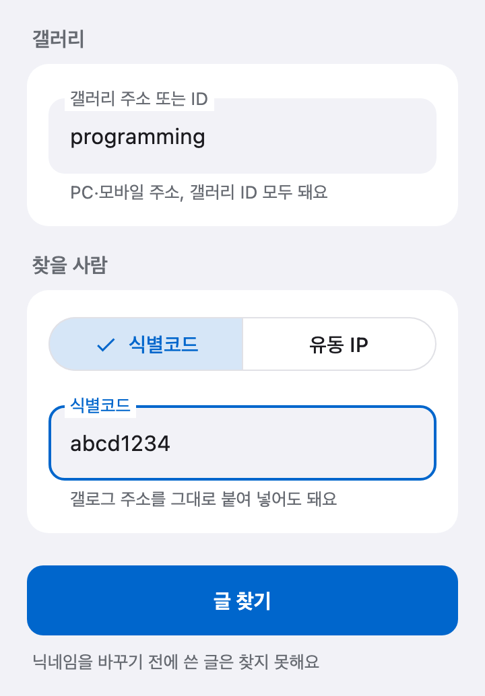
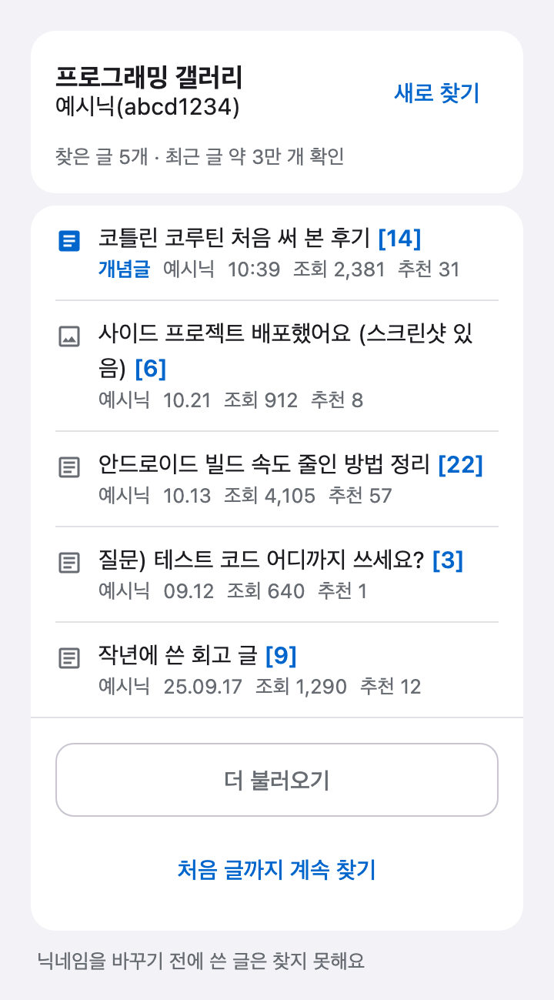

# 디시 반고닉 글 검색

**"이 반고닉, 우리 갤에 무슨 글 썼더라?"** 글 목록을 한 장씩 넘기며 찾지 마세요.

갤러리 주소와 **식별코드**만 넣으면, 디시클리너가 그 사람이 갤러리에 쓴 글만 골라 최신순으로 모아 줘요. **유동 IP**로 찾는 것도 돼요.

[디시클리너 무료 다운로드](https://github.com/dccleaner3/dccleaner/releases/latest){: .cta} Android · Windows · macOS

{: .jump}
[어떻게 찾나요?](#how-it-works) [사용법](#how-to) [식별코드 찾는 법](#uid) [알아 두면 좋아요](#tips) [자주 묻는 질문](#faq)

---

## 이런 분께 좋아요

- 디시 **반고닉·고닉 작성글**을 한 갤러리에서 모아 보고 싶은 분
- **식별코드로 글 검색**을 하고 싶은데 디시 검색으로는 다른 사람 글이 섞이는 분
- **유동(ㅇㅇ) 아이피**로 같은 사람이 쓴 글을 찾아보고 싶은 분

## 어떻게 찾나요? {#how-it-works}

디시의 글쓴이 검색은 **닉네임**으로 찾아요. 그래서 닉네임이 같거나 비슷한 다른 사람의 글까지 함께 나와요.

디시클리너는 그 검색 결과에서 **식별코드(또는 유동 IP)가 같은 글만** 남겨요.

1. 식별코드로 찾으면 먼저 갤로그에서 **지금 닉네임**을 확인해요.
2. 그 닉네임으로 갤러리를 **최근 글부터** 거슬러 올라가며 검색해요.
3. 식별코드나 IP가 맞는 글만 골라 **최신순**으로 보여 줘요.

---

## 사용법 {#how-to}

### 1. 반고닉 글 찾기 열기

로그인한 뒤 아래 탭 **더보기** → **반고닉 글 찾기**를 눌러요.

### 2. 갤러리 넣기

**갤러리 주소 또는 ID** 칸에 갤러리를 넣어요. [갤창랭킹](./gallery-ranking.html)과 같은 형식이 다 돼요.

- PC 주소: `https://gall.dcinside.com/board/lists/?id=갤러리ID`
- 마이너·미니 갤러리 주소
- 모바일 주소: `https://m.dcinside.com/board/갤러리ID`
- 갤러리 ID만

### 3. 찾을 사람 넣기

**찾을 사람**에서 **식별코드**나 **유동 IP**를 골라요.

  

| 방식 | 넣는 것 | 예 |
| --- | --- | --- |
| 식별코드 | 고닉·반고닉의 식별코드 | `abcd1234` 또는 갤로그 주소 |
| 유동 IP | IP 앞 두 자리 + 글쓴이 닉네임 | `118.235` + `ㅇㅇ` |

- 식별코드 칸에는 PC 갤로그(`gallog.dcinside.com/식별코드`)나 모바일 갤로그(`m.dcinside.com/gallog/식별코드`) 주소를 그대로 붙여 넣어도 돼요.
- IP는 닉네임 옆 괄호 안의 숫자예요. `(118.235)`처럼 괄호째 넣어도 돼요.
- 디시 검색이 닉네임으로만 되기 때문에, 유동 IP로 찾을 때는 **글쓴이 닉네임**도 넣어야 해요. 유동 기본 닉네임은 `ㅇㅇ`이라 처음부터 채워져 있어요.

{: .warn}
> **⚠️ 유동 IP는 섞일 수 있어요** 디시는 유동 IP를 앞 두 자리만 보여 줘요. 그래서 같은 IP 대역을 쓰는 다른 사람의 글이 섞일 수 있어요. 통신사(모바일 데이터) IP는 특히 많이 겹쳐요.

### 4. 글 찾기

**글 찾기**를 누르면 최근 글부터 찾기 시작해요. 찾은 글은 디시 글 목록처럼 보여요.

  

- **[말머리] 제목 [댓글 수]**, 글쓴이, 날짜, 조회, 추천
- 개념글은 **개념글** 표시가 붙어요.
- 위쪽에 **찾은 글 N개 · 최근 글 약 N만 개 확인**처럼 얼마나 찾아봤는지 보여요.

### 5. 더 예전 글까지 찾기

한 번에 다 찾지 않고, 최근 글부터 조금씩 찾아요. 목록 아래 버튼으로 이어서 찾아요.

| 버튼 | 하는 일 |
| --- | --- |
| **더 불러오기** | 더 예전 글을 한 번 더 찾아요 |
| **계속 찾기** | 최근 범위에서 못 찾았을 때 더 예전 글까지 찾아요 |
| **처음 글까지 계속 찾기** | 누르지 않아도 갤러리 첫 글까지 이어서 찾아요 |
| **중지** | 찾던 것을 멈춰요. 찾은 글은 그대로 남아요 |

끝까지 다 보면 **처음 글까지 다 확인했어요**가 떠요.

{: .tip}
> **💡 팁** 큰 갤러리는 디시가 막지 않게 천천히 찾아서 처음 글까지 오래 걸려요. 찾는 동안 다른 탭에 다녀와도 계속 찾고, 더보기의 반고닉 글 찾기 줄에 **찾는 중**이 붙어요.

### 6. 글 열기

찾은 글을 누르면 바로 열려요.

- **Android**: 디시 앱이 깔려 있으면 디시 앱으로, 없으면 앱 안 브라우저로 열어요. (미니 갤러리는 앱 안 브라우저로 열어요)
- **PC**: 기본 브라우저로 열어요.

다른 사람이나 다른 갤러리를 찾으려면 **새로 찾기**를 눌러요. 찾은 글이 있으면 사라지기 전에 한 번 더 물어요.

---

## 식별코드 찾는 법 {#uid}

식별코드는 닉네임이 아니라 **영문·숫자로 된 아이디**예요. 고닉·반고닉 모두 있어요.

1. 글쓴이 닉네임을 눌러 **갤로그**로 들어가요.
2. 주소 `gallog.dcinside.com/식별코드`의 **뒷부분**이 식별코드예요.

주소를 통째로 복사해서 식별코드 칸에 붙여 넣어도 돼요.

---

## 알아 두면 좋아요 {#tips}

- **닉네임을 바꾸기 전에 쓴 글은 찾지 못해요.** 디시 검색은 글마다 쓸 때의 닉네임으로 찾기 때문이에요.
- **글만** 찾아요. 댓글은 찾지 않아요.
- 한 번에 **한 갤러리, 한 사람**씩 찾아요.
- 이미 지워진 글이나, 글쓴이 정보를 숨긴 갤러리의 글은 찾을 수 없어요.
- 찾을 때 **내 계정으로 글을 쓰거나 지우지 않아요.** 공개된 검색 결과만 읽어요.
- 결과는 화면이나 탭을 옮겨도 남아 있어요. 로그아웃하거나 앱을 완전히 종료하면 지워져요.

> 공개된 글을 모아 보는 기능이에요. 찾은 글로 다른 사람을 괴롭히거나 신상을 캐는 데 쓰지 마세요. 디시클리너는 디시인사이드의 공식 프로그램이 아니에요.

---

## 자주 묻는 질문 {#faq}



---

## 다른 기능도 써 보세요

- [디시 갤창랭킹 만들기](./gallery-ranking.html): 우리 갤 갤창 순위를 이미지로
- [디시 댓글 자동삭제](./comment-auto-delete.html): 내 글의 광고 댓글을 알아서 지워요
- [디시 방명록 한 번에 보내기](./guestbook.html)
- [내가 쓴 글·댓글 한 번에 삭제하기](./help.html#both)
- [디시클리너 기능 전체 보기](./features.html)

[디시클리너 최신 버전 다운로드](https://github.com/dccleaner3/dccleaner/releases/latest){: .cta}
